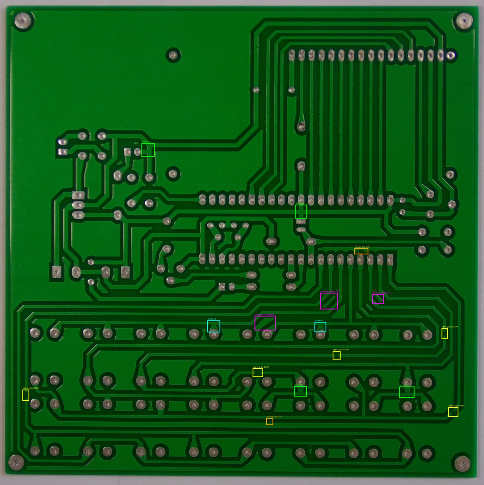
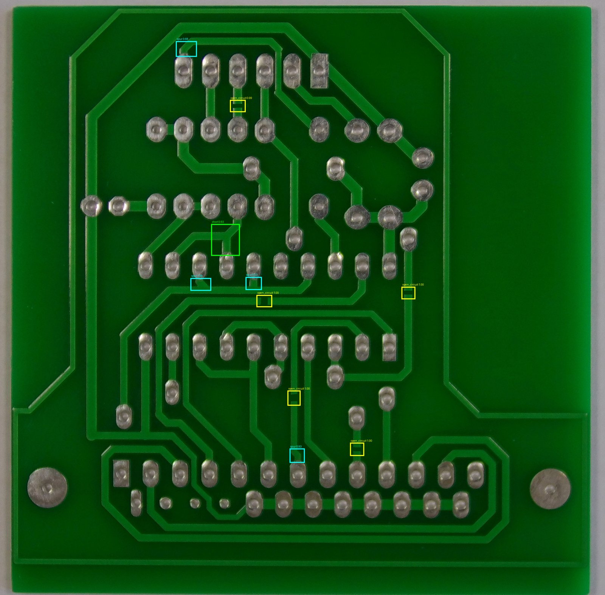
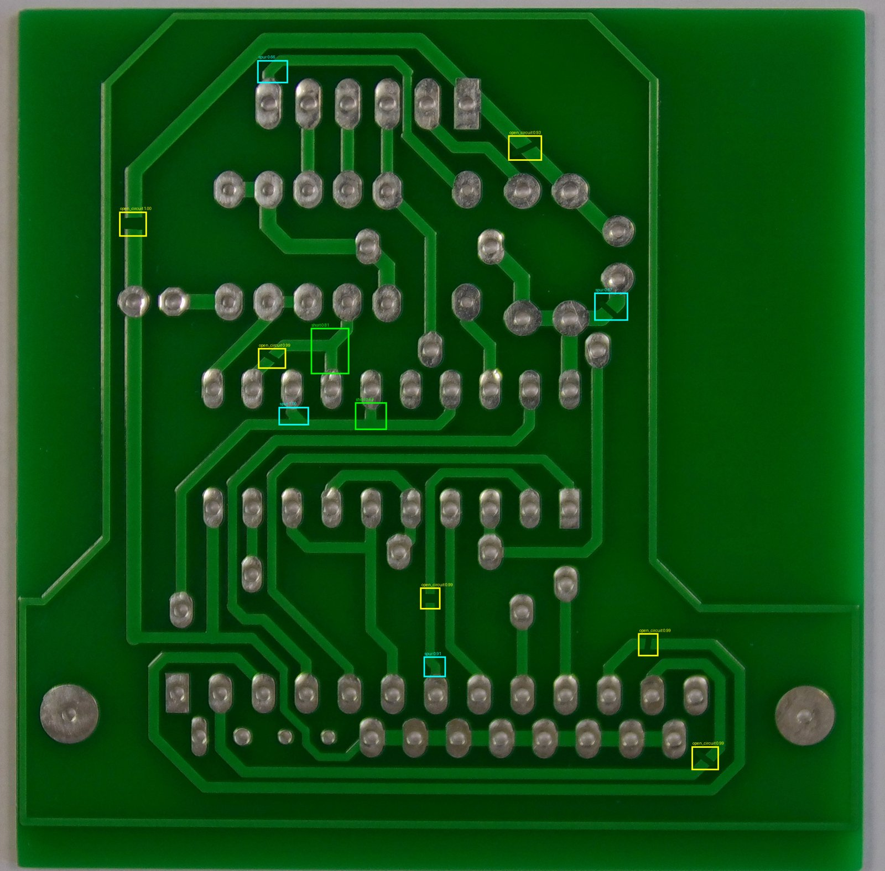

# Automated PCB Defect Detection Using Deep Learning

Upload a photo of a printed circuit board and the model finds and labels manufacturing defects.
It detects 6 defect types: missing hole, mouse bite, open circuit, short, spur and spurious copper.





## Results (held-out test boards)

| Metric | Score |
|---|---|
| mAP@50 | 0.838 |
| mAP@50:95 | 0.393 |

Per-class AP (COCO-style, averaged over IoU 0.50 to 0.95):

| Defect | AP |
|---|---|
| missing_hole | 0.386 |
| mouse_bite | 0.506 |
| open_circuit | 0.447 |
| short | 0.343 |
| spur | 0.300 |
| spurious_copper | 0.376 |

## Dataset

PKU-Market-PCB from Kaggle (akhatova/pcb-defects): 693 annotated images with 2953 labelled defects.
The split is done by board, so the same physical board never appears in two splits:
train 481 images (boards 01, 04, 06, 07, 08, 09), validation 92 (boards 05, 10), test 120 (boards 11, 12).

## Model and training

- Faster R-CNN with a ResNet-50 FPN backbone (torchvision), COCO-pretrained, with a new 7-class head (6 defects plus background)
- Anchor sizes 16 to 256 for small defects, input resized to min side 1024
- SGD (lr 0.01, momentum 0.9, weight decay 1e-4), cosine schedule, 12 epochs, batch size 4, mixed precision
- Horizontal flip augmentation; the best checkpoint is chosen by validation mAP@50
- Trained on a free Google Colab T4 GPU

## Run the demo

```
pip install -r requirements.txt
python app.py
```

Then open the local link, upload a PCB image, and adjust the confidence slider.
The weights in models/best.pt are stored mostly in half precision (normalisation layers kept in full precision) to stay under GitHub's file size limit.

## Files

- app.py: Gradio web demo
- pcb_core.py: model, dataset and drawing code
- models/best.pt: trained weights
- notebooks/: Colab notebook used for training and evaluation
- results/: example detections

## Limitations

- Small dataset (a few dozen boards), so results may not carry over to different board designs, cameras or lighting
- Weakest classes on the test boards: spur and short
- Very small defects can be missed, and the demo runs slowly on CPU
